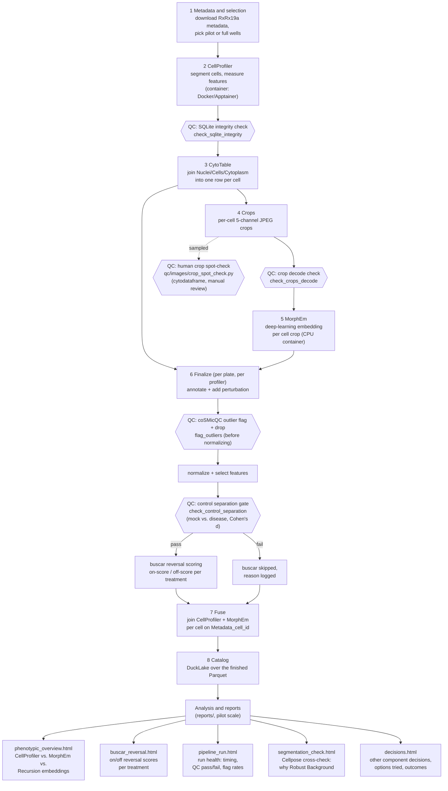
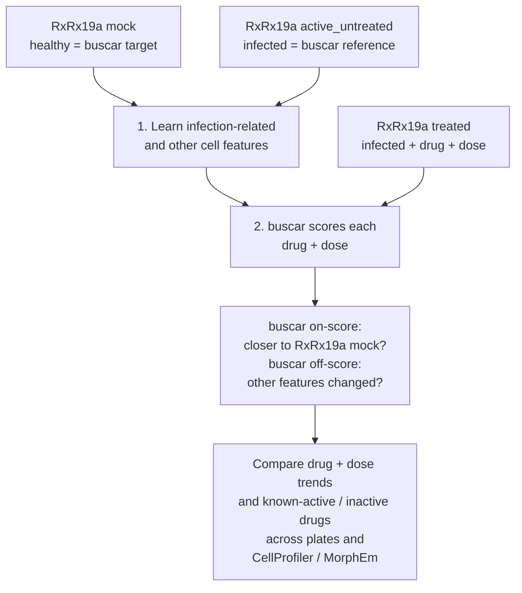

# RxRx19a reanalysis

This repository reanalyzes RxRx19a images to ask whether treatments move
SARS-CoV-2-infected cells toward a healthy appearance.
The pipeline is specific to RxRx19a, though some parts can be reused with
other datasets.

## Latest verified production results

As of October 28, 2026, the latest verified full run is
`rxrx19a-full-20261015T223716Z-g83c9641`.
Its results are on Alpine's Active PetaLibrary storage (koala):

```text
/pl/active/koala/ReRx/runs/rxrx19a-full-20261015T223716Z-g83c9641/
```

Completion was verified on October 28, 2026 at 04:05 UTC:
57 plates, all 12,768 planned shards, and 47,075,123 fused cell profiles.
Nextflow and the final Slurm job (`34971985`) exited successfully.
Important files and directories, relative to that results directory:

- `profiles/fused/feature_selected/` — combined CellProfiler and MorphEm profiles, partitioned by experiment and plate.
- `profiles/cellprofiler/feature_selected/` and `profiles/morphem/feature_selected/` — separate feature sets.
- `crops/cells/` — single-cell JPEG crops stored in Parquet.
- `catalog/run.ducklake` — SQL catalog pointing to the Parquet files in this run.
- `run_summary.json` — per-plate processing, biological QC, and buscar outcomes.
- `_SUCCESS` and `diagnostics/completion-verified-20261028T040528Z.json` — completion marker and independently checked counts.
- `diagnostics/resume-*/` — recovery records, including deployed patches and source hashes.

The run ID names the starting commit; reviewed recovery fixes were applied during the run and recorded under `diagnostics/`.
Technical completion does not mean every plate passed biological QC or received buscar scores; consult `run_summary.json` before interpreting results.
Keep these results in place: the catalog refers to their existing paths.
Update this section only after a newer full run has a verified `_SUCCESS` marker and matching plate, shard, and row counts.

### Reports and current findings

The [report index](reports/README.md) describes the existing HTML reports.
Open the HTML files locally in a browser.
These reports describe pilot runs and method checks, **not the latest full production run**:

| Report                                                  | Scope                                                  |
| ------------------------------------------------------- | ------------------------------------------------------ |
| [Phenotypic overview](reports/phenotypic_overview.html) | Pilot CellProfiler, MorphEm, and Recursion comparisons |
| [Buscar reversal](reports/buscar_reversal.html)         | Pilot treatment scores calculated at the well level    |
| [Pipeline health](reports/pipeline_run.html)            | Processing and QC for `pilot-x8`                       |
| [Segmentation check](reports/segmentation_check.html)   | Sampled-image segmentation comparison                  |
| [Method decisions](reports/decisions.html)              | Pipeline choices and checks that remain open           |

For the latest production run, use these files under the results directory above:

- `run_summary.json` — combined processing and biological QC outcomes, with one entry per plate and profiler.
- `qc/plates/<plate_id>.json` — detailed outcomes and skip reasons for each of the 57 plates.
- `diagnostics/completion-verified-20261028T040528Z.json` — independently verified completion and dataset counts.

The production counts and data contents are summarized in this README.
A full-production HTML report has not been added to `reports/`.
In particular, `pipeline_run.html` still describes `pilot-x8`.

Technical processing succeeded, but this run has **no buscar scores or signatures**.
The biological control-separation check failed for all 57 plates with both profilers, so `run_summary.json` records 114 skips.
Those skips are documented outcomes, not missing processing jobs.
They do not establish that treatments are ineffective or provide a production-wide treatment ranking.
The pilot buscar report uses well-level aggregation, and its scores must not be presented as results from this full run.
Recursion baseline comparisons and the pilot crop-review notebook are also absent from this full run.

### What the current dataset contains

The source is RxRx19a five-channel microscopy, with site and treatment annotations from Recursion's metadata archive.
The metadata contains 305,520 imaging sites across the HRCE-1, HRCE-2, VERO-1, and VERO-2 experiments.
A site is one microscope field, not one cell.

- **CellProfiler profiles** contain measurements of cell, nucleus, and cytoplasm shape, intensity, texture, and related properties.
  CytoTable joins the compartment measurements into one row per cell.
- **Cell crops** contain five masked grayscale JPEG images per cell, one per source channel.
  This run uses 96 × 96 pixels per channel and JPEG quality 95.
  The images are binary columns inside Parquet, not separate JPEG files.
- **MorphEm profiles** contain 1,920 learned features per cell, extracted from those five crops with the pinned MorphEm model.
  These values describe image appearance; they are not gene expression measurements.
- **Normalized profiles** contain per-plate transformations of the measurements.
  **Feature-selected profiles** retain the features that pass the pipeline's selection rules for that plate.
- **Fused profiles** join the selected CellProfiler and MorphEm features on `Metadata_cell_id`.
  They contain the cells present in both feature sets, not treatment-level scores.

The raw profiles and crops contain 48,191,464 cells.
CellProfiler QC excludes 1,116,341 outlier cells before normalization, leaving 47,075,123 cells in its selected and fused profiles.
MorphEm retains the original cell count.
Counts across profilers describe the same cells and must not be added as distinct cells.

### File walkthrough

This tree describes the verified run above, not every optional pipeline output.
`<e>`, `<p>`, `<plate_id>`, and `<shard_id>` stand for an experiment, plate, or processing batch.
Each `profiles.parquet` below represents one plate.
Each crop or raw MorphEm shard contains a batch of sites.

```text
rxrx19a-full-20261015T223716Z-g83c9641/
├── inputs/
│   ├── RxRx19a-metadata.zip                  # downloaded source annotations
│   └── metadata.csv                         # extracted source annotations
├── metadata/rxrx19a.parquet                  # parsed annotations, one row per site
├── selection.json                           # sites selected for this run
├── shards.json                              # complete shard plan
├── shard_plate_counts.tsv                   # shard-to-plate scheduling information
├── shard-plans/<shard_id>.json               # sites assigned to each shard
├── plate-plans/<plate_id>.json               # shards assigned to each plate
├── crops/cells/<shard_id>.parquet            # cell IDs, coordinates, five JPEG blobs
├── profiles/
│   ├── cellprofiler/
│   │   ├── raw/experiment=<e>/plate=<p>/profiles.parquet
│   │   ├── normalized/experiment=<e>/plate=<p>/profiles.parquet
│   │   └── feature_selected/experiment=<e>/plate=<p>/profiles.parquet
│   ├── morphem/
│   │   ├── raw/<shard_id>.parquet            # embeddings derived from cell crops
│   │   ├── normalized/experiment=<e>/plate=<p>/profiles.parquet
│   │   └── feature_selected/experiment=<e>/plate=<p>/profiles.parquet
│   └── fused/
│       ├── feature_selected/experiment=<e>/plate=<p>/profiles.parquet
│       └── fusion.json                      # join key, input counts, dropped cells
├── qc/plates/<plate_id>.json                 # per-plate QC and buscar skip reasons
├── run_summary.json                         # combined QC and processing outcomes
├── catalog/
│   ├── run.ducklake                         # active SQL catalog; points to Parquet
│   └── ducklake_data/                       # catalog bookkeeping directory
├── catalog.interrupted-20261027T200926Z/     # recovery backup; not the active catalog
├── diagnostics/
│   ├── completion-verified-20261028T040528Z.json
│   └── resume-*/                            # deployed patches and source hashes
└── _SUCCESS                                 # final publishing gate passed
```

Original source PNGs, segmentation masks, and CellProfiler SQLite working files are not part of this published results tree.
The cell crops and measurement tables are the durable image-derived results here.

### Browse the data with DuckDB

DuckDB is the query engine.
DuckLake makes the existing Parquet files appear as SQL tables.
The catalog is not a second copy of the profiles or images.
The following examples use the project's Python environment on Alpine, where the PetaLibrary paths are accessible.
They were verified against this catalog with DuckDB 1.5.6.

Use the same `RERX_ROOT` scratch root that you configured for the launcher.
Start Python from the Alpine checkout:

```bash
cd "${RERX_ROOT:?Set RERX_ROOT to your Alpine scratch root}/ReRx"
.venv/bin/python
```

Attach the active catalog read-only, then inspect its tables and columns:

```python
from pathlib import Path
import duckdb

run = Path("/pl/active/koala/ReRx/runs/rxrx19a-full-20261015T223716Z-g83c9641")
con = duckdb.connect(
    config={
        "memory_limit": "1GB",
        "threads": 1,
        "enable_external_file_cache": False,
    }
)
con.execute("INSTALL ducklake")
con.execute("LOAD ducklake")
con.execute(f"ATTACH 'ducklake:{run}/catalog/run.ducklake' AS rerx (READ_ONLY)")
con.execute("USE rerx")
con.sql("SHOW TABLES").show()
con.sql("DESCRIBE fused_feature_selected").show(max_rows=12)
```

`INSTALL` uses the local extension cache or downloads the extension when needed.
The current catalog contains these eight tables:

| Table                           | Rows       | Contents                                      |
| ------------------------------- | ---------- | --------------------------------------------- |
| `metadata`                      | 305,520    | Site annotations, treatments, doses, controls |
| `cellprofiler_raw`              | 48,191,464 | Joined measurements before outlier exclusion  |
| `cellprofiler_normalized`       | 47,075,123 | Normalized measurements after QC              |
| `cellprofiler_feature_selected` | 47,075,123 | Selected CellProfiler measurements            |
| `crops`                         | 48,191,464 | Cell coordinates and five JPEG binary columns |
| `morphem_raw`                   | 48,191,464 | Original MorphEm embeddings                   |
| `morphem_normalized`            | 48,191,464 | Normalized MorphEm embeddings                 |
| `fused_feature_selected`        | 47,075,123 | Joined selected CellProfiler and MorphEm data |

Column names vary by stage.
For example, fused profiles use `Image_Metadata_Experiment`, while normalized CellProfiler profiles use `Metadata_Experiment`.
Use `DESCRIBE` before writing queries against a different table.
Selected features also vary by plate.
The catalog combines their schemas and returns `NULL` for a feature absent from a plate.

Count imaging sites by experiment, then preview five fused cell records from one plate:

```python
con.sql("""
    SELECT experiment, cell_type, COUNT(*) AS sites
    FROM metadata
    GROUP BY experiment, cell_type
    ORDER BY experiment
""").show()

con.sql("""
    SELECT Metadata_cell_id, Image_Metadata_Experiment,
           Image_Metadata_Plate, Metadata_Well, Metadata_perturbation
    FROM fused_feature_selected
    WHERE Image_Metadata_Experiment = 'HRCE-1'
      AND Image_Metadata_Plate = '1'
    LIMIT 5
""").show()
```

`Metadata_cell_id` connects a cell across profiles and crops.
`crops.Metadata_site_id` connects that cell to `metadata.site_id` for disease, treatment, and dose annotations.
Join a small crop sample to those annotations without loading the JPEG columns:

```python
con.sql("""
    WITH cells AS (
        SELECT Metadata_cell_id, Metadata_site_id FROM crops LIMIT 5
    )
    SELECT c.Metadata_cell_id, m.disease_condition, m.treatment,
           m.treatment_conc
    FROM cells AS c
    JOIN metadata AS m ON c.Metadata_site_id = m.site_id
""").show()
```

The selected MorphEm files exist on disk but are **not registered as a separate table in this catalog**.
Read one plate directly with the same DuckDB connection:

```python
con.sql(f"""
    SELECT Metadata_cell_id
    FROM read_parquet(
        '{run}/profiles/morphem/feature_selected/experiment=HRCE-1/plate=1/profiles.parquet'
    )
    LIMIT 5
""").show()
con.close()
```

For browsing, select a few columns and use `LIMIT` rather than fetching whole tables into pandas.
The crop columns `crop_w1_jpeg` through `crop_w5_jpeg` are image blobs, not numerical features.
Use a Slurm compute allocation for large joins, exports, or model training, not a login-node session.

## What this pipeline does

The pipeline turns RxRx19a microscopy images into single-cell morphology
profiles.
It then uses buscar to score how much each treatment moves infected cells
toward the healthy state.

The pipeline has eight stages, in order:

1. **Metadata and selection** — download the RxRx19a metadata, then pick
   the wells for a run (a small pilot subset, or the full dataset).
1. **CellProfiler** — segment cells and measure per-cell features from
   the five-channel images. Runs in a container (Docker locally,
   Apptainer on Alpine).
1. **CytoTable** — join CellProfiler's per-compartment SQLite tables
   (Nuclei, Cells, Cytoplasm) into one row per cell, and add a stable
   `Metadata_cell_id`.
1. **Crops** — cut a JPEG crop of each cell from each of the five
   channels, for visual QC and embedding models.
1. **MorphEm** — run the MorphEm vision transformer over each cell's
   five-channel crop to get a 1,920-number deep-learning feature
   vector per cell (5 channels × 384 embedding dims). Runs in its own
   Apptainer container, on CPU.
1. **Finalize (per plate, per profiler)** — annotate, normalize, and
   select features with Pycytominer for both CellProfiler and MorphEm
   profiles, run a biological QC gate, and run buscar reversal
   scoring. See "Why the pipeline batches by plate" below.
1. **Fuse** — join the two feature sets per cell on `Metadata_cell_id`
   into one combined profile (`rerx.fuse`), written under
   `profiles/fused/` with a `fusion.json` sidecar.
1. **Catalog** — build a read-only DuckLake catalog over the finished
   Parquet files, so anyone can query the run with plain SQL.

Pilot finalization also writes a human crop spot-check notebook
(`qc/images/crop_spot_check.py`, built by `rerx.qc_notebook` — a small,
seeded-random sample of per-cell crops rendered with
[`cytodataframe`](https://github.com/cytomining/CytoDataFrame) so a person
can open it in Jupyter and visually confirm segmentation looks centered
and masked correctly). It is a convenience output of pilot runs, not a
pipeline stage with its own data to pass downstream.

The diagram below shows the same eight stages as data flowing left to
right, with the QC checks placed where they actually run, and the
pilot analysis reports that read the finished catalog at the end:



Two runners drive this pipeline:

- Local, small runs: `tests/test_pilot_e2e.py` (an opt-in end-to-end
  test) shows the full call sequence against a real CellProfiler
  container.
- Alpine HPC, full-scale runs: `workflows/main.nf` (Nextflow, Slurm
  executor) calls `scripts/rerx_tasks.py`, a thin command-line driver
  that wraps the same library functions under `src/rerx/`.

## Why the pipeline batches by plate

Each plate is its own biological batch: it has its own mock (healthy) and
disease (active, untreated) control wells, and normalization must
compare cells against controls from the *same* plate, not a different
one.

This has three effects on the code:

- `rerx.cytotable.plate_partitions` groups cell profiles by
  `(experiment, plate)`. Every downstream step consumes one plate's
  group at a time.
- `rerx.finalize.finalize_plate` runs annotate, normalize,
  feature-select, the control-separation QC gate, and buscar for one
  plate. It never holds more than one plate's cells in memory.
- A full run processes plates in separate Slurm tasks. The final task
  checks every plate before it publishes the catalog and `_SUCCESS`.

The local full selection from RxRx19a metadata contains 305,520 sites
across 57 plates. With 24 sites per shard, it plans 12,768 shards.

### Full run on Alpine

The full workflow has completed on Alpine; see the verified results above.
Before a new launch, check that compute nodes can reach the chosen Active
PetaLibrary path and that the allocation has enough space.
Use a clean checkout at the commit named in the new run ID.
Run the launcher on a suitable workflow-head node inside `tmux`:

```bash
export PATH="/curc/sw/install/bio/nextflow/25.10.2_env/bin:$PATH"
export RERX_ROOT=<scratch-root>
export RERX_PETA_ROOT=<active-petalibrary-root>
export SLURM_ACCOUNT=<allocation>
uv run poe run_full
```

`uv run poe run_full` pins `RERX_SCOPE=full` and, unless you already set
`RERX_RUN_ID` yourself, generates a fresh timestamped
`rxrx19a-full-<UTC>-g<sha>` ID. To resume an incomplete run, set both
`RERX_RUN_ID` and `RERX_RESUME=1`. Use `uv run poe run_pilot` the
same way for a pilot run; it pins `RERX_SCOPE=pilot`. Both wrap
`scripts/alpine_launch.sh` (see `pyproject.toml`'s `[tool.poe.tasks]`),
so scope can't be set to the wrong value by a stale environment
variable.

`RERX_ROOT/ReRx` must contain this checkout. The launcher writes run
outputs to `RERX_PETA_ROOT/runs/RERX_RUN_ID`. It keeps task work in
scratch. It will not reuse a completed run ID. Set `RERX_RESUME=1` only
to restart an incomplete run with the same inputs and code.

The full run downloads five images per site in bounded shard tasks.
It finalizes CellProfiler and MorphEm profiles, runs buscar per plate,
and joins each cell's two profiles. It publishes a DuckLake catalog only
after every planned shard and plate passes validation. The Recursion
baseline and projection commands remain pilot-only; this full workflow
does not run those comparisons.

### If the final task fails

Do not start a new full run just because catalog publishing failed.
The scientific Parquet files remain usable, but the run is not complete until `_SUCCESS` exists.

1. Check Slurm's job state and exit code, then the task's `.command.out`, `.command.err`, and the launch directory's `.nextflow.log`.
   An out-of-memory kill may leave no Python traceback; the last flushed stage and Slurm record identify where it stopped.
1. Keep the run ID, original checkout path, `RERX_ROOT/launch/<run_id>/` (including its `.nextflow` cache), and `RERX_ROOT/nextflow_work/<run_id>/`.
   Do not remove these directories or the completed plate outputs.
1. If a catalog build was interrupted, move its partial `catalog/` directory to a uniquely named backup before rebuilding, keeping any WAL with it.
   Do this only after confirming no publishing task is running; do not alter the referenced Parquet files.
1. Resume the incomplete run with its original environment, `RERX_RUN_ID=<incomplete-run-id>`, and `RERX_RESUME=1`, then run `uv run poe run_full`.
   Nextflow should reuse unchanged completed tasks; changes to code, inputs, or paths can invalidate its cache, so inspect the resume log rather than assuming only the final task will run.
   The launcher refuses to reuse an already completed full run ID.
1. Confirm Nextflow exited with code zero, `_SUCCESS` exists, and `run_summary.json` matches the planned plates before calling the run finished.
   For the current full selection, expect 57 plates and 12,768 shards.

The safeguards from this production run are already in the code:
catalog schemas are read one file at a time, DuckDB uses a 4 GB buffer limit and two threads, and progress logs include process memory.
The buffer limit is not a cap on total process memory.
`COMPLETE_FULL` starts with 256 GB on `amem`, allows 12 hours, and increases memory on its two retries.
The catalog must finish before `_SUCCESS` is written; a failure propagates rather than marking a partial run successful.
The local tests and workflow preview do not prove that a full Alpine run will finish within the current time and storage limits.

If a future project has a different batching unit (for example, per
96-well plate barcode, or per acquisition day), replace
`plate_partitions`'s group key. The rest of `finalize_plate` does not
change.

## The biological QC gate

A technically clean run (every SQLite integrity check passes, every
crop decodes) can still carry bad biology — a failed stain, or a dead
plate where nothing grew. `rerx.validate.check_control_separation`
catches this case.

The check compares the mock and disease control populations on every
morphology feature, using Cohen's d effect size. If the median absolute
effect size falls below a threshold (0.5 by default), the check fails
for that plate.

This check runs before buscar, not after, for a concrete reason: buscar
itself raises an error when there is no separating feature between mock
and disease (division by zero inside its Earth Mover's Distance
calculation). `finalize_plate` checks first, then skips buscar with a
clear reason logged, instead of letting the whole run crash on one bad
plate.

## buscar reversal scoring

Here is the whole comparison: RxRx19a provides healthy, infected, and
infected-plus-treatment wells. buscar learns what infection changes from
the first two groups, then scores each drug and dose against them. It
runs separately for each plate and feature set (CellProfiler or MorphEm)
after the control-separation QC check passes.



**What the labels mean:** RxRx19a `mock` means uninfected wells; these
fill buscar's **target** (healthy) role. RxRx19a `active_untreated`
means infected wells with no drug; these fill buscar's **reference**
(disease) role. RxRx19a `treated` wells contain infected cells given a
particular drug and dose. buscar's target/reference roles are not drug
controls: Remdesivir (known active) and Oseltamivir carboxylate (known
inactive) are drugs used to check whether the scores behave sensibly.
RxRx19a `uv` (inactivated virus) is another check, not buscar's target
or reference. There are no vehicle-only wells in RxRx19a, so its
`active_untreated` group is a disease-reference analog, not literally
"disease + vehicle."

**How scoring works:** buscar uses the two control groups on the same
plate to identify features that differ with infection (the *buscar on*
signature) and features that do not (the *buscar off* signature). For
each RxRx19a drug-and-dose group, the buscar on-score measures distance
from the healthy buscar target in infection-related features. RxRx19a
`active_untreated` has a buscar on-score of **1.0** by construction; a
score near **0** is closer to RxRx19a `mock`. The buscar off-score
measures the fraction of other features that change compared with
RxRx19a `mock`; lower is better for both scores. A buscar on-score can
exceed 1.0. These are morphology comparisons, not proof that a drug
treats infection or is free of side effects. buscar scores each group
against RxRx19a `mock`, using RxRx19a `active_untreated` to set the
buscar on-score scale; it does not compare two drugs directly.

**What we can compare from the scores:** Each scored plate and feature
set produces buscar on-scores and buscar off-scores for drug-and-dose
groups and RxRx19a controls. We can then compare dose trends and
known-active versus known-inactive drugs. Across plates, we can check
whether these patterns repeat. By scoring CellProfiler and MorphEm
separately, we can ask whether the two feature sets favor the same
treatments. Their feature values and signatures differ, so compare
score patterns rather than raw features. A plate whose healthy and
infected controls do not separate is skipped, not given buscar scores.

The finalize stage records RxRx19a well labels in
`Metadata_rxrx_control_type`, and groups replicates for scoring with
`Metadata_perturbation` (for example,
`Remdesivir (GS-5734)__1.0`). `Metadata_buscar_state` labels wells for
inspection but is not used to calculate scores. For each scored plate
and profiler, buscar writes `signatures.parquet` (on/off feature lists)
and `scores.parquet` (one row per group, including
`on_buscar_scores` and `off_buscar_scores`; the healthy buscar target
itself is excluded from this score table).

## Other run outputs

The file walkthrough under "Latest verified production results" describes the current full run.
Pilot runs can also contain Recursion site embeddings under `baseline/`, comparison results under `comparisons/`, and a crop-review notebook under `qc/images/`.
Runs that pass the biological control-separation check can contain buscar signatures and scores under `buscar/<profiler>/experiment=<e>/plate=<p>/`.
These optional outputs are not present in the current full run.

Parquet remains the canonical data; the catalog only refers to those files.
For an interrupted catalog, follow the recovery steps above rather than removing files from a completed run.

## Memory footprint at scale

The `finalize` step (annotate/normalize/select/buscar/fuse/validate)
streams: it holds one plate's rows (or one shard's crops) in memory
at a time, never the whole run. Memory scales with the largest single
plate, not the full dataset — see `src/rerx/streaming.py` and the
comment on the `FINALIZE` process in `nextflow.config`.

One step does not yet stream: `recursion-buscar` downloads and
converts Recursion's published site-embedding archive (~1.5 GB
zipped) into one Parquet file in memory. It must run as a Slurm job,
not on a login node — a login-node run OOM-killed on Alpine's ~1.6 GB
per-user cap. `FINALIZE`'s 64 GB Slurm allocation covers it today;
revisit if the published archive grows.

## Adapting this pipeline to a different dataset

Four things are specific to RxRx19a today, and each has a clear home if
you port this pipeline to a different imaging dataset:

- **Metadata schema and channel layout** — `src/rerx/metadata.py` (URL
  format, column names, five-channel naming).
- **Control taxonomy** — `src/rerx/pycytominer.py`'s
  `RXRX_CONTROL_*` constants and `rxrx_control_type` (map your dataset's
  own control labels to the same three-column pattern:
  `Metadata_rxrx_control_type`, `Metadata_pycytominer_control_type`,
  `Metadata_buscar_state`).
- **CellProfiler pipeline** — `pipelines/rxrx19a.cppipe` is tuned for
  this dataset's cell type and stains. A new dataset needs its own
  `.cppipe`, built and validated the same way.
- **Batching unit** — `rerx.cytotable.plate_partitions`, as described
  above.

Everything else — sharding, container invocation, CytoTable conversion,
crops, MorphEm embedding, the QC gate, buscar, fusion, the catalog, and
the Nextflow/Slurm orchestration — works unchanged.

## Experiment specs

`experiments/` holds experiments written as specs before they run: every
consequential choice is a decision with a written rationale, every output
names the decisions that shape it, and each universe picks one option per
decision. See `experiments/README.md` for the format and the validator.

## Canopy workflow harness

`canopy/` holds Canopy, a reusable workflow harness that runs tickets
through a journaled loop: a stage follows a written procedure skill, a
check runs a real command, a gate holds the run until the checks pass,
and a terminal hands the result to a person. The `src/canopy` package
has no rerx imports, so it can be lifted to other projects as-is. See
`canopy/README.md` for the document format, the skill format, and the
`rerx agent` commands.

## References

`CITATION.cff` lists every paper, dataset, and tool this project cites
or depends on. Cite this software using the `authors` metadata at the
top of that file.
